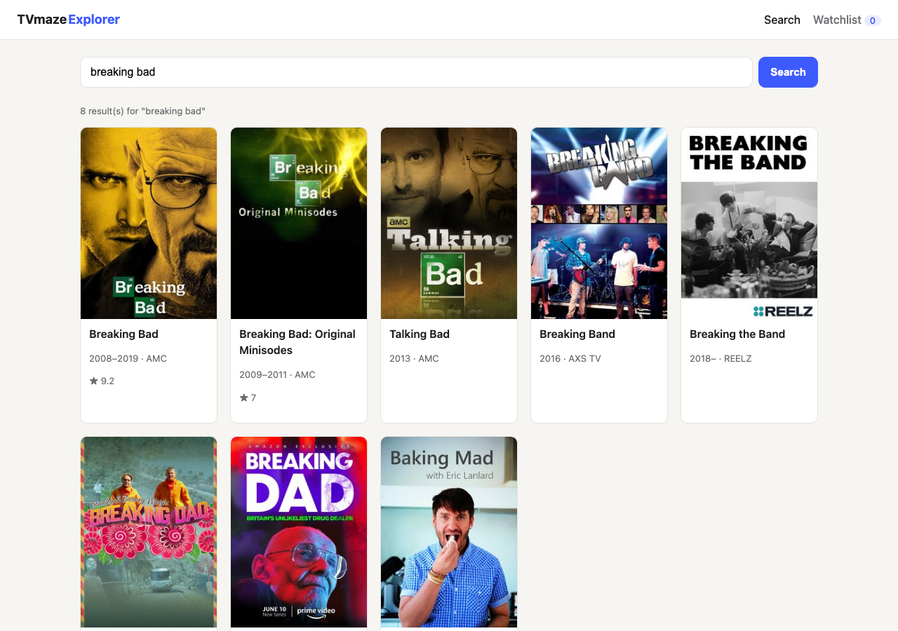
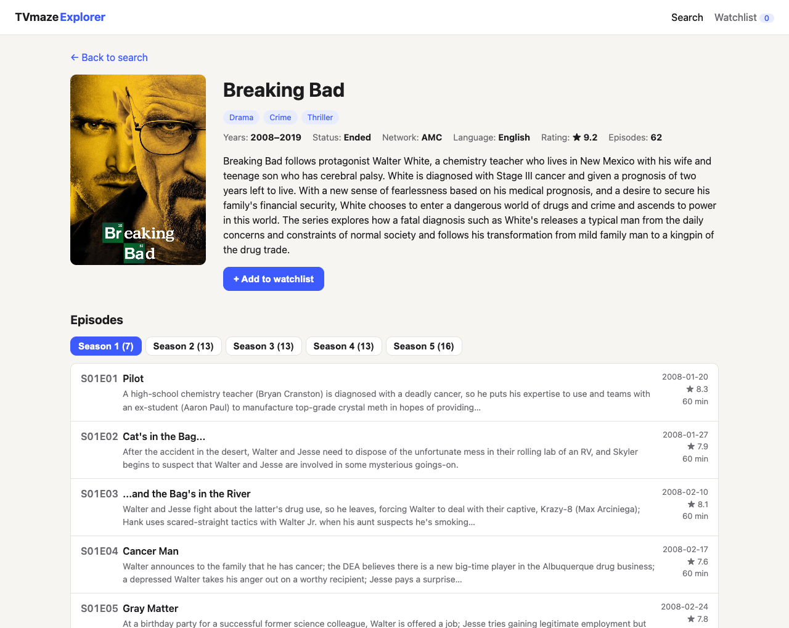
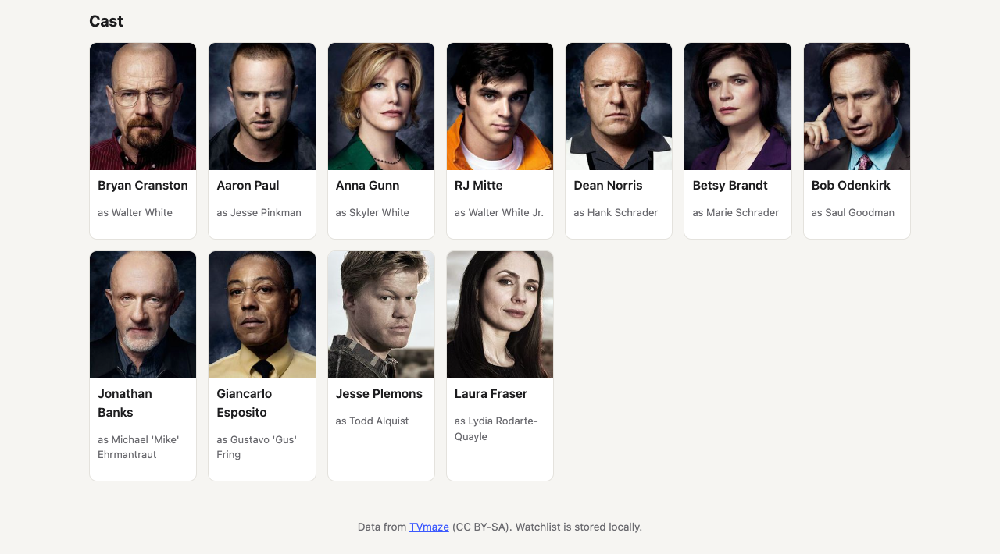
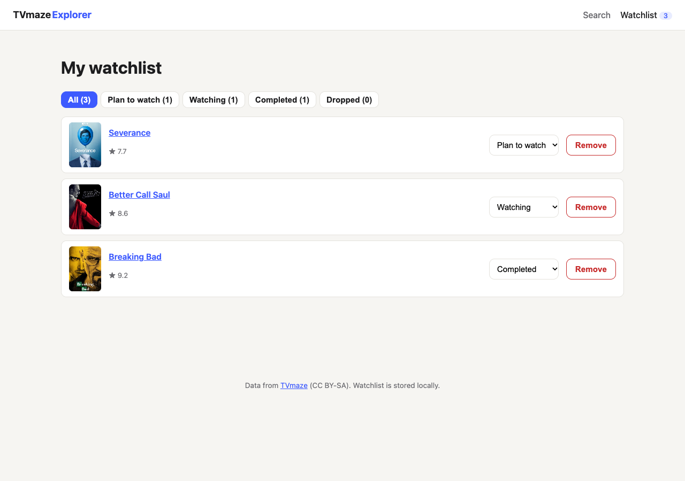

# TVmaze Explorer

A small local web app to search TV series by name, open a series to see its episodes (grouped by season) and cast, and keep a personal watchlist.

| Search | Series detail |
|---|---|
|  |  |
| **Cast** | **Watchlist** |
|  |  |

## Purpose

Finding basic facts about a series — when it ran, how many seasons it has, who is in it — usually means clicking through ad-heavy sites. This app answers those questions in three steps:

1. **Search** a series by name.
2. **Open** a result to see its details.
3. **Browse** the episode list per season and the main cast.

**Additional feature: Watchlist.** Any series can be added to a personal watchlist with a status (*Plan to watch*, *Watching*, *Completed*, *Dropped*). The watchlist page can be filtered by status, and the status can be changed or the series removed at any time.

## Data collection

All series data comes from the public [TVmaze API](https://www.tvmaze.com/api) (free, no API key, CC BY-SA).

| App endpoint | TVmaze endpoint | Used for |
|---|---|---|
| `GET /api/search?q=<name>` | `GET /search/shows?q=<name>` | Search results |
| `GET /api/shows/:id` | `GET /shows/:id?embed[]=episodes&embed[]=cast` | Detail page, episodes and cast in **one** call |

- The browser never calls TVmaze directly; the local Express server does (`src/tvmaze.js`) and returns a cleaned-up version (only the fields the UI needs, HTML stripped from summaries, episodes grouped by season).
- TVmaze allows roughly 20 requests per 10 seconds. Responses are cached in memory for 5 minutes, and a `429` from TVmaze is shown to the user as "try again in a few seconds".

## Data persistence

- **Series data** is not stored; it is fetched live (plus the short in-memory cache).
- **The watchlist** is stored in a local JSON file (`data/watchlist.json` by default, configurable via `WATCHLIST_FILE`). Each entry holds the show id, name, poster URL, TVmaze rating, the user's status and timestamps (`addedAt`, `updatedAt`).
- Writes go to a temporary file first and are then renamed, so a crash cannot leave a half-written file. Writes are queued so two quick clicks cannot overwrite each other.
- The `data/` folder is git-ignored, so personal watchlists never end up in the repo.

## User interaction

| View | URL | What you can do |
|---|---|---|
| Search | `#/` or `#/?q=friends` | Type a series name, see posters, years, network and rating |
| Series detail | `#/show/<id>` | Summary, genres, facts, season tabs with all episodes, cast grid, add to watchlist / change status |
| Watchlist | `#/watchlist` | Filter by status, change status, remove, jump to a series |

Routes live in the URL hash, so searches and series pages can be bookmarked and the browser back button works.

## Setup

Requirements: Node.js 20 or newer. No paid services and no API keys are needed.

```bash
git clone https://github.com/hj7f2ytj8s-sys/TVMaze.git
cd TVMaze
npm install
cp .env.example .env      # optional, defaults work
npm start                 # → http://localhost:3000
```

Run the tests:

```bash
npm test
```

The tests use Node's built-in test runner and fake TVmaze responses (`test/fixtures.js`), so they run offline and never hit the real API. The runner also counts `test/fixtures.js` as a passing entry, so the 28 results are 27 tests plus that file. Latest run: [`docs/test-log.txt`](docs/test-log.txt).

### Project structure

```
server.js            entry point (loads .env, binds to localhost)
src/app.js           Express routes and error handling
src/tvmaze.js        TVmaze client, caching, response normalisation
src/watchlist.js     JSON-file watchlist store
public/              frontend (index.html, app.js, lib.js, styles.css)
test/                unit + integration tests
docs/                test log and screenshots
```

## Learning

- **Embedding requests**: TVmaze's `embed[]` parameter returns show, episodes and cast in one request instead of three, which matters with a rate limit.
- **Dependency injection for testing**: the TVmaze client takes a `fetch` function and the app takes its client and store as arguments, so every part can be tested without network access.
- **Safe rendering**: TVmaze summaries contain HTML. They are stripped on the server and the frontend only writes text with `textContent`, so no API data is ever injected as HTML.
- **Small-scale persistence**: atomic writes and a write queue make a JSON file a reasonable store for a single-user local app.

### Challenge: a clean install failed

- **Problem**: `package-lock.json` listed different dependency versions than `package.json`. `npm install` silently rewrote the lockfile, so the app and tests ran fine, but `npm ci` (which installs exactly what the lockfile says) stopped with an error.
- **Approach**: the unexpected change to the lockfile after installing was the clue. The failure was reproduced with `npm ci` on a copy of the committed files, the lockfile was regenerated from `package.json`, and `npm ci` and the tests were run again.
- **Takeaway**: commit `package.json` and `package-lock.json` together, and test the setup from a clean copy, not only in a folder that already works.

## Limitations and assistance

**Limitations**
- Search returns at most 10 results (a TVmaze limit) and has no pagination.
- The watchlist is per machine and single-user; there are no accounts and no sync.
- The cache is in memory and is lost on restart.
- Some shows have no poster, rating or cast in TVmaze; the UI shows placeholders.
- Only English UI; summaries are shown in whatever language TVmaze provides.

**Assistance**
- AI: the code, tests and this README were drafted by Claude (Anthropic). Claude Code then installed the dependencies, ran the tests, clicked through the app in headless Chrome, took the screenshots, found and fixed the lockfile problem described above, and ran the publication audit ([`AUDIT.md`](AUDIT.md)).
- External code: [Express](https://expressjs.com/) and [dotenv](https://github.com/motdotla/dotenv).
- Data and images: [TVmaze](https://www.tvmaze.com/) under CC BY-SA.
